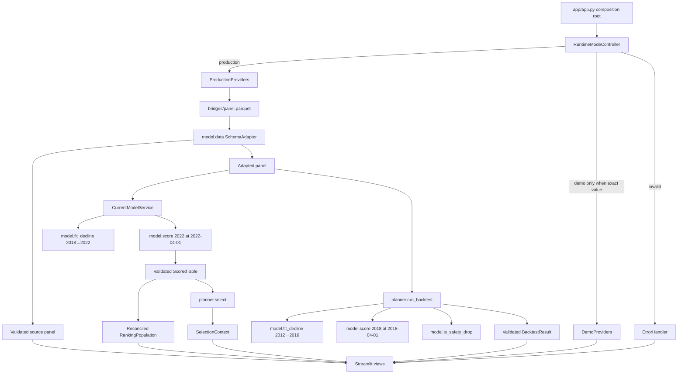

# Design Document: Production Bridge Inspection Planner

## Overview

This design turns the existing Streamlit prototype into the final-submission Massachusetts Bridge Inspection Planner described by the approved requirements. The production application runs from a clean Git checkout with `streamlit run app/app.py`, loads the version-controlled `bridges/panel.parquet`, validates and adapts that source exactly once, reuses the existing `model.fit_decline` and `model.score` behavior, and delegates deterministic selection and historical evaluation to a new real `planner` package. Demo execution remains available only through the exact, case-sensitive `BRIDGE_APP_MODE=demo` setting and can never be selected as a fallback for a production error.

The design has five governing rules:

1. **Provenance is decided before data access.** An absent mode means production; an invalid mode stops all data-derived rendering; production and demo providers are never mixed. (Requirements 1.1–1.17)
2. **The source/model schema boundary exists in one place.** The existing `model/data.py` adapter is strengthened into the sole source validator and adapter instead of introducing a competing mapping in `app/` or `planner/`. (Requirements 2.1–2.30)
3. **Existing model logic is composed, not copied.** Current ranking and backtest call the public `model.fit_decline(panel, start, end)`, `model.score(table, rates, asof)`, and shared `model.is_safety_drop`; wrappers add input bounding, cache identities, and output validation only. (Requirements 3.1–3.27, 5.2–5.18)
4. **One immutable selection context drives the rerun.** The active budget is read before rendering, one statewide selection is computed, and every dependent view receives the same object. Map filtering affects markers only. (Requirements 4.1–4.21, 6.1–6.20, 7.1–7.28)
5. **Validation is transactional and failures are dependency-scoped.** A value enters a cache or renderer only after its contract passes; errors disclose a fixed component/summary/code tuple while one structured server event retains the exception class and message. (Requirements 8.1–8.18)

### Existing implementation reconciliation

| Existing behavior | Design decision | Requirement rationale |
| --- | --- | --- |
| `app/app.py` catches every real import error and silently imports `stubs` | Remove the broad fallback. Resolve mode first and construct either production providers or demo providers explicitly. Import/initialization failures in production become user-safe production failures. | 1.7–1.14, 8.16 |
| `app/data.py` chooses `fake.parquet` when `panel.parquet` is missing | Remove path fallback. Production always requests `bridges/panel.parquet`; demo alone may request `bridges/fake.parquet` or generated demo records. | 1.10–1.15, 2.1, 9.5–9.7 |
| `latest_year()` drops rows without coordinates before scoring | Replace it with a complete year slice. A dedicated map projection applies coordinate eligibility only after scoring and selection. | 3.8–3.11, 6.13–6.20 |
| `model/data.py` already renames `structure_id`, renames inspection frequency, derives `year_built`, and does not map repair cost to inspection cost | Retain this module as the only adapter, add strict source validation and reconciliation, and stop changing `year_recon == 0` to null because the approved adapter must preserve every other source value. Existing model code already understands zero as “never reconstructed.” | 2.18–2.26 |
| `model.score.fit_decline` filters to the requested endpoint years, pairs shared IDs, and excludes null/rebuilt ending pairs | Call it with an already bounded two-year frame as defense in depth. Do not reimplement fitting in app or planner. | 3.1–3.6, 5.2–5.6 |
| `model.score.score` already returns `id`, `p_worse`, `consequence`, `insp_cost`, `score`, `reason` and computes the required formula | Keep the implementation and validate its result. The only required text contract change is replacing “placeholder cost” with the exact phrase “modeled inspection-cost estimate” in generated reasons and related model documentation/tests. | 3.9–3.19, 7.21–7.22 |
| `app/stubs.py` fabricates scores and a backtest that forces “ours” to win | Move/rename it as an explicitly demo-only provider. It must not satisfy production interfaces by accidental import, and demo output is visibly labeled at every data-derived view/download. | 1.5–1.17, 5.18, 7.28 |
| `planner/` contains only `.gitkeep` | Add a package exposing validated deterministic selection, baseline ordering, and a two-phase leakage-free backtest. | 4.1–4.21, 5.1–5.28 |
| `requirements.txt` is unpinned and combines undeclared roles | Replace it with exact direct manifests and Linux/Python-3.11 resolved locks; add a runtime declaration, deployment guide, dependency verifier, and CI workflow. | 9.1–9.20, 10.1–10.17, 11.19–11.25 |

### Research findings that inform the design

- Streamlit Community Cloud checks out the repository and runs Streamlit from the repository root; for a nested entry point, the dependency file may remain at the root. Local launch should therefore also occur at the root, while all asset paths should still be anchored to `__file__`, not assumed current working directory. See [Streamlit file organization](https://docs.streamlit.io/deploy/streamlit-community-cloud/deploy-your-app/file-organization).
- Community Cloud chooses Python in Advanced settings. The deployment guide will require Python **3.11**, matching a checked-in `.python-version`, rather than relying on the platform default. See [Streamlit deployment settings](https://docs.streamlit.io/deploy/streamlit-community-cloud/deploy-your-app/deploy).
- Streamlit’s `AppTest.from_file(...).run(timeout=...)` can execute and inspect a Streamlit entry point headlessly, so the smoke check can be one bounded, noninteractive production render without starting a long-running web server. See [Streamlit AppTest API](https://docs.streamlit.io/develop/api-reference/app-testing/st.testing.v1.apptest).
- GitHub recommends selecting Python explicitly with `actions/setup-python`; the workflow will read the same 3.11 declaration, use an Ubuntu runner to match Community Cloud, and install checked-in locks. See [GitHub’s Python build-and-test guidance](https://docs.github.com/en/actions/use-cases-and-examples/building-and-testing/building-and-testing-python).
- Repository inspection found a 600,379-byte real panel with 20,757 rows and the exact 21 required columns. It contains 5,251 unique 2022 IDs. All current 2022 records happen to have coordinates, but the implementation and tests must retain no-coordinate records because that is a contract, not an observation about this revision.
- The existing timing sample reports roughly 1.0 seconds to load, 5.4 seconds to fit 2018→2022, and 0.9 seconds to score 5,251 rows. Content hashing and one additional cached 2012→2016 backtest fit leave substantial margin under the 120-second initial-render requirement.

External documentation findings above are paraphrased. Content was rephrased for compliance with licensing restrictions.

### Scope and non-goals

This feature changes integration, planning, presentation, deployment, and validation. It does not redesign the decline algorithm, select the optional logistic model, download fresh NBI data at runtime, optimize a knapsack globally, or claim that the measured planner must beat either baseline. The approved greedy score order and measured outcomes are the product contract.

## Architecture

### Target repository layout

```text
hackachusetts-2027/
├── .github/workflows/validate.yml       # clean Ubuntu CI, locks → tests → smoke
├── .python-version                      # exactly: 3.11
├── README.md                            # local and Community Cloud deployment guide
├── requirements.txt                    # resolved runtime lock used by Streamlit Cloud
├── requirements-test.txt               # resolved runtime + test lock
├── requirements/
│   ├── runtime-direct.txt               # exact direct runtime pins only
│   └── test-direct.txt                  # exact direct test/tooling pins only
├── scripts/
│   ├── validate_dependencies.py         # pin, installed-version, graph, import checks
│   └── smoke_app.py                     # one AppTest production render, ≤120 seconds
├── app/
│   ├── __init__.py
│   ├── app.py                           # path bootstrap, page setup, composition root
│   ├── config.py                        # exact runtime-mode resolution
│   ├── services.py                      # providers, caches, current/backtest orchestration
│   ├── state.py                         # active-budget and immutable view context
│   ├── views.py                         # rendering only; no model/planner calls
│   ├── errors.py                        # taxonomy, logging, scoped error renderers
│   ├── demo.py                          # explicit demo providers; no production imports
│   └── style.py                         # existing CSS, retained
├── model/
│   ├── __init__.py                      # existing public model API plus adapter exports
│   ├── data.py                          # sole source validation/adaptation boundary
│   ├── score.py                         # existing fit/score; narrow reason-text adjustment
│   └── target.py                        # existing shared Safety_Drop definition
├── planner/
│   ├── __init__.py                      # public select/run_backtest exports
│   ├── contracts.py                     # scored/backtest contract validators
│   ├── selection.py                     # deterministic budget/fixed-count selection
│   └── backtest.py                      # historical plan then outcome evaluation
├── bridges/panel.parquet                # required version-controlled production asset
└── tests/
    ├── unit/                            # pure validators, adapter, planner, presenters
    ├── integration/                     # real model/planner/cache/error boundaries
    └── app/                             # AppTest interaction/provenance scenarios
```

The root path bootstrap is deliberately limited to the first executable lines of `app/app.py`: derive `REPO_ROOT = Path(__file__).resolve().parents[1]`, insert its string into `sys.path` once if absent, and only then import `app`, `model`, and `planner` by absolute package name. Adding `app/__init__.py` and `planner/__init__.py` makes import intent explicit. This is preferable to relying on Streamlit’s script-directory behavior or the caller’s working directory, and does not require Community Cloud to perform an editable install. After bootstrap, no module mutates `sys.path`. Asset paths are independently resolved from module files. (Requirements 9.2–9.5)

### Runtime component graph



Every arrow that produces a cacheable or renderable value crosses a validator first. Demo providers produce mode-tagged equivalents but are assembled on a disjoint branch. The UI receives a `ViewContext`; it never imports demo data, calls the model, calls the planner, or chooses a source path itself.

### Startup and rerun sequence

```mermaid
sequenceDiagram
    participant ST as Streamlit
    participant MC as Mode Controller
    participant DA as Schema Adapter
    participant CA as Validated Cache
    participant MO as Existing Model
    participant PL as Real Planner
    participant UI as Views

    ST->>MC: resolve(BRIDGE_APP_MODE)
    alt absent or production
        MC-->>ST: ProductionMode + production provenance
        ST->>DA: hash/read/validate panel.parquet
        DA-->>ST: source + adapted + dataset digest
        par current ranking
            ST->>CA: fit/score keys
            CA->>MO: fit_decline(2018, 2022)
            CA->>MO: score(full 2022, rates, 2022-04-01)
            MO-->>CA: validated ScoredTable
        and measured backtest
            ST->>CA: backtest key
            CA->>PL: run_backtest(adapted panel, budgets)
            PL-->>CA: validated BacktestResult
        end
        ST->>PL: select(validated scores, active budget)
        PL-->>ST: one validated SelectionContext
        ST->>UI: render dependency-scoped ViewContext
    else exact demo
        MC-->>ST: DemoMode + demo providers
        ST->>UI: render labeled demo context
    else any other value
        MC-->>UI: MODE-001; no data-derived context
    end
```

Mode resolution occurs before cache lookup, file access, or data-derived rendering. `RuntimeMode` is an enum with only `PRODUCTION` and `DEMO`; an absent variable returns production, exact lowercase literals return their corresponding mode, and every other present value raises `InvalidRuntimeMode`. There is no `.lower()`, trimming, truthiness rule, command-line override, or fallback. Provider construction uses explicit `if mode is ...` branches. Demo imports are lazy inside the demo branch, and production objects carry `Provenance(mode=PRODUCTION, data="Real_Dataset", model="Real_Model_Service", planner="Real_Planner", backtest="Backtest_Engine")`. A provider-bundle invariant rejects a component whose mode tag differs from the active mode before any dependent rendering. (Requirements 1.1–1.17)

### Data and dependency boundaries

The source pipeline has four stages:

1. Compute SHA-256 by streaming the exact repository asset bytes. At the current 0.6 MB size, doing this on each rerun is inexpensive and gives a true content key rather than an mtime approximation.
2. Read the same production path as Parquet into a source frame and validate it without coercion or mutation.
3. Deep-copy and adapt through `model.data` only.
4. Score the complete adapted 2022 slice, validate the exact score contract, and reconcile it one-to-one to the untouched source 2022 records for presentation.

A map frame is a projection of the reconciled population, never an input to scoring or selection. County filtering and coordinate eligibility are applied to that projection only. This architecture guarantees that future source revisions containing null coordinates remain in population counts, choices, metrics, details, hazards, and exports. (Requirements 2.1–2.30, 3.6–3.11, 6.11–6.20)

The rendering dependency graph is explicit:

| Result | Depends on | Failure scope |
| --- | --- | --- |
| Source and static Methods text | mode, source read/schema (Methods text itself is static) | Data/schema failure suppresses all data-derived output; safe static guidance may remain |
| Current scores/reconciled population | source, adapter, current model | Suppress current-ranking headline and score-dependent output |
| Current selection | current scores, active budget, planner | Suppress headline, red highlights, selection metrics/tables/hazards/export; an unselected score map may remain |
| Backtest | source, adapter, backtest engine | Suppress Backtest only; preserve valid current ranking |
| Bridge detail | source history, reconciled row | Suppress the failed detail panel only |
| Export bytes | selection context | Suppress download only; preserve on-screen selection |

Each component returns either a validated value or raises a typed internal exception handled once at its boundary. The composition root stores independent outcomes, so one branch cannot erase an unrelated validated branch. (Requirements 8.1–8.18)

### Validated cache architecture

Streamlit caching is wrapped rather than used directly in views:

- `@st.cache_data` stores the validated source bundle metadata/data frames, scored tables, and backtest results.
- `@st.cache_resource` stores fitted `DeclineRates`, because it is a model object reused by scoring.
- Underscore-prefixed frame arguments may be excluded from Streamlit’s implicit hashing only when an explicit immutable key containing the required content digest is supplied.
- Validation executes inside the cached function before return; exceptions therefore never populate a cache.
- A `force_recompute(key)` path first evicts that exact entry. If recomputation or validation then fails, no prior value remains under the identity. Recovery stores only the newly validated value.
- The UI never reaches into Streamlit cache APIs; `ModelCache` owns lookup, exact-key eviction, and test instrumentation counters.

| Cached value | Complete explicit identity |
| --- | --- |
| Source bundle | active mode, repository-relative asset identity, SHA-256 of exact file bytes, schema contract version |
| Current `Model_State` | active mode, source SHA-256, start `2018`, end `2022`, model-family identifier `fit_decline`, and a versioned model-configuration fingerprint covering score/fitting constants |
| Current `Scored_Table` | active mode, canonical complete-2022 adapted-frame digest, current Model_State identity, `2022-04-01`, and scoring-configuration fingerprint |
| `Backtest_Result` | active mode, source SHA-256, sorted distinct requested-budget tuple, `2012`, `2016`, `2018`, `2022`, `2018-04-01`, model fingerprint, and planner fingerprint |

The adapted-frame digest includes ordered column names, dtypes, null markers, and values after deterministic ID ordering. It does not use Python’s randomized `hash()`. Including mode in every identity prevents any demo/production cache crossover. Function source changes also cause Streamlit invalidation, but are not substituted for the explicit contract keys. (Requirements 1.16–1.17, 3.20–3.26, 5.23–5.28, 8.14–8.18)

## Components and Interfaces

### 1. Entrypoint and package bootstrap

`app/app.py` is a thin composition root. Before local imports it adds the file-derived repository root to `sys.path`; afterward it:

1. sets page configuration and injects existing CSS;
2. resolves mode;
3. builds exactly one provider bundle;
4. establishes/validates active budget before any selection;
5. independently requests source, current ranking, selection, and backtest outcomes;
6. creates one immutable `ViewContext`; and
7. calls render functions in visual order: current-ranking headline, `Map`, then `Budget`, `Backtest`, `Bridge detail`, `Hazards`, `Export`, and `Methods`.

No model, planner, schema, or export algorithm lives in this file. Absolute imports (`from app...`, `from model...`, `from planner...`) are used everywhere after bootstrap. A direct production-import test executes `runpy`/AppTest from the repository root and a temporary foreign working directory to prove paths are file-relative. (Requirements 6.1–6.2, 9.2–9.5, 10.16)

### 2. Runtime mode and provenance

`app/config.py` defines:

```text
resolve_runtime_mode(env: Mapping[str, str]) -> RuntimeMode
build_provider_bundle(mode: RuntimeMode) -> ProviderBundle
validate_provider_bundle(bundle, active_mode) -> None
```

`resolve_runtime_mode` reads only `BRIDGE_APP_MODE`. A missing key is production; `production` and `demo` are the only valid present values. An empty string, whitespace, different case, or any other value raises before provider construction. `ProviderBundle` includes explicit mode and provenance tags. Production provider constructors import the real `model` and `planner` package; demo constructors import `app.demo` only in the demo branch. Production exceptions are never caught and replaced with demo objects. (Requirements 1.1–1.17)

`render_demo_indicator()` emits the exact text `DEMO MODE - FABRICATED DATA`. Every data-rendering function begins with a shared `render_mode_notice(context)` call, and the Export renderer calls it immediately before its download control as well. Centralizing this guard avoids relying on individual authors to remember the label. (Requirement 1.15)

### 3. Sole schema adapter (`model.data`)

The existing module becomes the authoritative integration boundary and exports:

```text
read_source_panel(path: Path) -> DataFrame
validate_source_panel(source: DataFrame) -> None
adapt_source_panel(source: DataFrame) -> DataFrame
load_panel_bundle(path: Path, mode: RuntimeMode) -> PanelBundle
validate_scored_table(scored: DataFrame, ranking_ids: Sequence[str]) -> None
reconcile_scored_table(source_2022: DataFrame, scored: DataFrame) -> DataFrame
```

`read_source_panel` performs no fallback and no normalization. `validate_source_panel` accumulates deterministic issue codes internally but raises one `SourceSchemaError` without exposing rows to the user. Checks are vectorized and follow the approved contract exactly:

- column tuple equals the 21-name source tuple, including order;
- years are true integral values (booleans rejected), all belong to `{2012, 2016, 2018, 2022}`, and all four are represented;
- `(structure_id, year)` is unique; IDs are strings and nonempty after trimming; required descriptive strings are nonempty;
- `age`/`adt` are finite nonnegative integers and inspection frequency is a finite positive integer;
- nullable ratings are finite integral values in `[0, 9]`; rowwise `worst_rating` equals the minimum non-null component and is null if and only if all three are null;
- the three flags are actual Boolean values, not truthy strings or integers;
- reconstruction year is zero or an integer in `[1700, record.year]`;
- nullable improvement cost is finite/nonnegative and nullable coordinates are finite/in range;
- inspection date is present, parseable as a timestamp without coercing source data, is the first day of a month, and is no later than April 1 of its record year.

`adapt_source_panel` first deep-copies the validated source, renames only `structure_id → id` and `insp_freq_months → insp_freq_mo`, and adds `year_built = year - age`. It does **not** convert reconstruction zero to null, map `improvement_cost` to `insp_cost`, trim strings, drop rows, drop columns, impute values, or rewrite the input. Postconditions compare source/adapted row counts and every preserved column value (null-aware), and check one-to-one `(structure_id, year) ↔ (id, year)` correspondence. The old `model.load_panel()` remains only as a compatibility wrapper over this same implementation and does not define another mapping. (Requirements 2.1–2.26)

`validate_scored_table` enforces exact ordered columns, exact set/cardinality equality to ranking IDs, one row per ID, no null output, finite numeric fields, bounded probability, positive consequence/cost, nonnegative score, formula equality under a documented tight floating tolerance, and nonblank reason. Because the source has no per-bridge `insp_cost`, current real scores must disclose `modeled inspection-cost estimate` in every reason and may never derive cost from `improvement_cost`. (Requirements 3.9–3.19, 3.27)

`reconcile_scored_table` validates both inputs, then performs a one-to-one merge from source `structure_id` to score `id` with merge cardinality validation and an equality check of both ID sets. It returns presentation rows with source-facing `structure_id`; the model `id` may be retained only as internal audit metadata, not as a competing displayed identifier. Missing, duplicate, or unexpected IDs raise `IdentifierReconciliationError` before dependent output. (Requirements 2.27–2.30)

### 4. Current real-model service

`app/services.py` defines a `CurrentModelService` that receives functions from the public `model` package for testability but defaults to `model.fit_decline` and `model.score`:

```text
fit_current(adapted_panel, cache_key) -> DeclineRates
score_current(adapted_panel, rates, cache_key) -> ScoredTable
build_current_ranking(bundle) -> CurrentRanking
```

`fit_current` constructs a frame containing exactly years 2018 and 2022 and calls `fit_decline(frame, 2018, 2022)`. This both satisfies and makes observable the existing function’s own endpoint filtering, shared-ID pairing, null-condition exclusion, and end-record rebuilt exclusion. A model-state validator checks the expected 48-month horizon and finite probabilities in `[0, 1]`. (Requirements 3.1–3.5)

`score_current` takes the complete adapted 2022 frame before any coordinate operation and calls `score(table, rates, pd.Timestamp("2022-04-01"))`. It passes the output and complete ranking IDs to the sole score validator/reconciler. The model implementation remains responsible for probability, consequence, estimated inspection cost, formula, and explanation; the service never recalculates or “fixes” an invalid model output. (Requirements 3.6–3.19, 3.27)

One narrow edit to `model/score.py` is anticipated during implementation: when fallback cost is used, replace the reason fragment `placeholder cost $…` with `modeled inspection-cost estimate $…`, and update module/contract comments and existing tests to that public phrase. Constants and arithmetic remain unchanged. This reconciles terminology without duplicating scoring or altering rankings. (Requirements 3.18–3.19, 7.21–7.22)

### 5. Deterministic real planner

`planner/__init__.py` exports stable public interfaces:

```text
select(scored: DataFrame, *, budget: Real | None = None,
       count: Integral | None = None) -> Selection
summarize_selection(scored: DataFrame, selection: Selection) -> SelectionMetrics
run_backtest(adapted_panel: DataFrame, budgets: Iterable[Real]) -> BacktestResult
```

`select` validates the exact Scored_Table contract before creating order. Exactly one of budget/count must be supplied. Booleans are rejected as numbers. Budget accepts a finite nonnegative real value; fixed count accepts a nonnegative integer type. Candidates use stable order `score` descending, then `str(id)` ascending. Duplicate input IDs are invalid rather than silently deduplicated. (Requirements 4.1–4.7, 4.12, 11.7)

Budget mode converts each validated model cost and budget through `Decimal(str(value))` for comparison and accumulation, iterates deterministic order, appends an ID when cost is no greater than remaining budget, and continues past an unaffordable candidate. Fixed-count mode returns the first `min(N, row_count)` IDs. The returned `Selection` is immutable and validates order, uniqueness, membership, count semantics, and affordability before return. (Requirements 4.8–4.18)

`summarize_selection` derives, rather than stores independently, exact selected count, decimal cost sum from selected Scored_Table values, and `math.fsum` of selected probabilities. The same metrics object is shown in headline and Budget; display formatting may round visually but raw model values remain available for tables/export. (Requirements 4.19–4.21, 6.9–6.10, 7.1)

### 6. Leakage-free backtest engine

The backtest is split into a historical planning phase that cannot access outcomes and a later evaluation phase:

```text
build_historical_plan(panel_through_2018, budgets,
                      fit_fn=model.fit_decline,
                      score_fn=model.score) -> BacktestPlan

evaluate_outcomes(plan: BacktestPlan, outcomes_2022,
                  target_fn=model.is_safety_drop) -> BacktestRun

run_backtest(adapted_panel, budgets) -> DataFrame[budget, method, caught]
```

`run_backtest` validates and partitions the panel before delegation. `build_historical_plan` is passed only 2012, 2016, and 2018 records. It passes exactly 2012/2016 rows to `fit_decline(..., 2012, 2016)`, scores the complete unique 2018 table at `2018-04-01`, validates it, and freezes the common candidate ID set, model-produced 2018 inspection-cost map, and all method selections before a 2022 frame is obtained. Tests can inject spies that assert the maximum visible year at each boundary. (Requirements 5.1–5.10, 5.26, 11.9)

All three methods use the same candidate IDs, scored 2018 `insp_cost`, requested budget, and shared affordability iterator:

- `ours`: validated Scored_Table order (`score` descending, ID ascending);
- `worst_first`: 2018 `worst_rating` ascending, null last, ID ascending;
- `oldest_first`: 2018 `age` descending, ID ascending.

`evaluate_outcomes` receives frozen selections plus the 2022 slice. It validates at-most-one records, excludes any selected ID missing either endpoint, having either rating null, or having `rebuilt=True` in 2022, and calls the existing `model.is_safety_drop(start, end)` for each eligible pair. It counts booleans without changing values based on method comparison. `BacktestRun` retains private selected/eligible counts for validation while its public table contains exactly `budget`, `method`, `caught`, ordered by budget ascending and enum order `ours`, `worst_first`, `oldest_first`. Duplicate requested budgets collapse to distinct sorted values. (Requirements 5.11–5.22, 5.27)

The backtest validator checks exact schema, numeric budget set, one row per budget/method, method set/order, integral nonnegative counts, and `caught <= eligible_selected_count`. Invalid results raise before caching/rendering. (Requirements 5.19–5.28)

### 7. Shared application state and view context

`app/state.py` defines `get_active_budget(session_state, requested_value)`. It initializes both `active_budget` and `last_valid_budget` to `500000`. A valid value must be one member of `range(100000, 3000001, 50000)`; invalid injected/query/test state restores the last valid member. The widget lives in the sidebar or top controls and is evaluated before selection. (Requirements 6.3–6.6)

After budget validation, the composition root calls `planner.select` exactly once and builds:

```text
ViewContext
  mode and Provenance
  source PanelBundle
  CurrentRanking (complete reconciled population)
  active_budget
  Selection and SelectionMetrics
  BacktestResult outcome (independent success/failure)
```

Renderers receive this object and cannot request another selection. In one Streamlit rerun, changing the widget creates a new context before any view renders, so headline, map, Budget, detail, Hazards, Export, and selection-dependent Methods content change together. County selection is a map-render argument, not an input to `planner.select`. (Requirements 6.6–6.12)

### 8. Presentation components

`app/views.py` contains small renderers and pure preparation helpers:

- **Headline:** active budget, selected/total counts, exact selected cost, and expected Safety_Drop coverage from `SelectionMetrics`; production provenance is adjacent. Expected coverage remains a numeric sum and is not rounded into a claim of observed “declines caught.”
- **Map:** starts from all reconciled ranking records, applies the exact finite coordinate ranges, then optional county filtering. Every eligible record produces one marker. Selected IDs are red. Unselected score color uses one fixed sequential palette with min-max normalization; equal scores map equally and normalized values cannot decrease as score rises. Radius uses a fixed nondecreasing transform such as `base + scale * sqrt(adt)` after validated nonnegative ADT. Tooltip includes `structure_id`, carries, crosses, county, and score. (Requirements 6.13–6.20)
- **Budget:** displays the shared metrics and selected records ordered hazard descending, score descending, `structure_id` ascending. Inspection cost headings and captions say modeled inspection-cost estimate. (Requirements 7.1–7.4, 7.21)
- **Backtest:** plots the three measured series directly. Comparisons always use the same selected budget (normally active budget). Copy is generated by a pure formatter: positive/nonzero baseline may show difference and ratio; positive/zero baseline omits ratio; equal-or-worse results show exact counts and never say “more declines caught.” (Requirements 7.5–7.9)
- **Bridge detail:** options come from the complete ranking population. History is reindexed to `[2012, 2016, 2018, 2022]`, sorted ascending, and null/missing cells display `Unavailable`; no imputation is performed. It shows model reason and source carries/crosses/county. A URL helper associates the URL-encoded selected ID with the FHWA InfoBridge bridge-detail/search route; its contract test verifies the ID is present, while the guide records the stable FHWA base URL. (Requirements 7.10–7.13)
- **Hazards:** computes `underwater OR fracture_critical` from 2022 source booleans, intersects exactly with the shared selection, and uses the common hazard/score/ID ordering. (Requirements 7.14–7.15)
- **Export:** builds bytes only from shared selected IDs and reconciled real values. Columns are exactly `county`, `structure_id`, `worst_rating`, `score`, `insp_cost`, `hazard`, `carries`, `crosses`, `reason`; rows sort county ascending, hazard descending, score descending, ID ascending. Adjacent copy names Real_Dataset, Real_Model_Service, Real_Planner, active budget, selection identity, and states that `insp_cost` is a modeled estimate and excludes `improvement_cost`. (Requirements 7.16–7.22)
- **Methods:** states the NBI source, NBI→SNBI transition, source/adapted mapping and reconciliation, 2018→2022 current fit with 2022-04-01 ranking date, 2012→2016 fit/2018 selection/2022 outcome timeline, Safety_Drop branches, rebuilt exclusion, modeled-cost assumptions, and all four production provenance components. (Requirements 7.23–7.28)

Visual order is headline, immediately visible `Map`, then secondary labeled sections. Existing tabs may remain for the six secondary sections, but the map is moved out of a tab so it is rendered before them. No renderer recomputes data, scores, selection, or backtest. (Requirements 6.1–6.2)

### 9. Error handling and scoped results

`app/errors.py` defines internal exception classes, immutable `UserSafeError`, and one boundary helper:

```text
run_component(component, operation, error_category) -> Outcome[T]
log_failure_once(exception, public_error) -> None
render_user_safe_error(public_error) -> None
```

`UserSafeError` has exactly three rendered fields: `component`, fixed `summary`, and stable `code`. Suggested category registry:

| Code | Component | Fixed summary |
| --- | --- | --- |
| `MODE-001` | Runtime_Mode_Controller | Runtime mode configuration is invalid. |
| `DATA-001` | Real_Dataset | Production bridge data could not be loaded. |
| `SCHEMA-001` | Schema_Adapter | Production bridge data failed validation. |
| `RECON-001` | Schema_Adapter | Model results could not be matched to bridge records. |
| `MODEL-FIT-001` | Real_Model_Service | The decline model could not be initialized. |
| `MODEL-SCORE-001` | Real_Model_Service | Bridge scores could not be validated. |
| `PLANNER-001` | Real_Planner | The inspection selection could not be created. |
| `BACKTEST-001` | Backtest_Engine | Historical comparison results are unavailable. |
| `DETAIL-001` | Bridge detail | The selected bridge detail is unavailable. |
| `EXPORT-001` | Export | The selected plan could not be exported. |

The registry, not exception text, determines public content. `log_failure_once` makes one logger call with structured JSON keys `error_code`, `component`, `exception_class`, and `exception_message`; a handled marker prevents nested boundaries from logging the same exception twice. The UI never receives stack traces, paths, environment values, secrets, exception messages, or raw rows. The composition root renders an error before that component’s dependent section and passes successful independent outcomes onward. (Requirements 8.1–8.13)

Cache wrappers evict an exact identity before forced recomputation and perform transactional validate-then-store. A later valid rerun replaces a failure outcome only after validation and stores only that valid value. Production mode remains active through all production failures; the error path has no import or call to demo providers. (Requirements 8.14–8.18)

### 10. Deployment package and validation pipeline

The dependency design uses four files with non-overlapping roles:

- `requirements/runtime-direct.txt`: exact `==` pins for `streamlit`, `pandas`, `pyarrow`, `pydeck`, `numpy`, and `scikit-learn`. OR-Tools and Matplotlib are omitted unless future production code directly imports them; the required greedy planner and Streamlit charts need neither.
- `requirements/test-direct.txt`: exact `==` pins for test-only packages, including `pytest`, `hypothesis`, and any selected timeout/coverage helper. It contains no runtime packages.
- root `requirements.txt`: generated, checked-in, fully resolved runtime lock for Python 3.11/Linux, with every direct/transitive distribution exactly pinned and hashed. This is what Community Cloud installs.
- root `requirements-test.txt`: generated, checked-in, fully resolved union of runtime and test dependencies, exactly pinned and hashed. CI installs it after the runtime lock; `pytest` never appears in the runtime direct file or runtime lock.

Lock generation is a maintainer operation performed in a clean Python-3.11 Linux environment from the two direct manifests. CI never resolves an open range. `scripts/validate_dependencies.py` rejects non-`==` entries, missing hashes/resolved pins, direct/lock drift, and test packages in the runtime set; compares each lock-represented installed distribution with its pin; runs `pip check`; and imports Streamlit, pandas, PyArrow, PyDeck, NumPy, scikit-learn, `model`, `planner`, and the backtest export. Install commands use `--require-hashes`. (Requirements 10.1–10.17)

`.python-version` contains `3.11`; README and CI refer to that same major/minor. `README.md` is the Deployment_Guide and includes:

- runtime installation and separate test-overlay commands;
- root launch command `streamlit run app/app.py`;
- entry point `app/app.py`, Python 3.11, and Community Cloud placeholders `<github-owner>/<repository>` and `<branch>`;
- mode values, production default, explicit case-sensitive demo activation, exact demo indicator, and no-fallback production failure behavior;
- production runtime asset `bridges/panel.parquet` and statement that no download/generation/secrets are required;
- pytest and standalone smoke commands;
- Community Cloud Advanced settings values and troubleshooting based on public error codes.

`.github/workflows/validate.yml` runs on every pull request and pushes to the configured shared/default branch (`main`, adjusted only if the repository designates another shared branch). One Ubuntu job performs: checkout; setup Python from `.python-version`; validate manifest syntax; install runtime lock; install test lock; validate versions/graph/imports; invoke `python -m pytest` exactly once in non-watch mode; then invoke `python scripts/smoke_app.py` exactly once with `BRIDGE_APP_MODE=production`. A job-level timeout bounds failure, while AppTest enforces the 120-second render limit. Tests block sockets or fail unexpected network calls, and all data uses local fixtures or checked-in assets. (Requirements 9.1–9.20, 10.1–10.17, 11.19–11.25)

## Data Models

### Source and adapted panels

`SOURCE_COLUMNS` is the immutable ordered tuple:

```text
structure_id, year, county, material, age, adt, deck, super, sub,
worst_rating, insp_freq_months, fracture_critical, underwater,
year_recon, rebuilt, lat, lon, carries, crosses, improvement_cost,
insp_date
```

| Field group | Source contract | Adapted representation |
| --- | --- | --- |
| Identifier | nonempty `structure_id`; unique with year | renamed to `id`, value unchanged |
| Time | year in four-year set; valid month-start inspection date bounded by April 1 | unchanged; add `year_built = year - age` |
| Descriptors | nonempty county/material/carries/crosses | unchanged |
| Numeric inputs | nonnegative integral age/ADT, positive integral frequency, ratings and geographic/cost bounds as specified | `insp_freq_months` renamed to `insp_freq_mo`; all values unchanged |
| Flags | exact booleans | unchanged |
| Reconstruction/repair | bounded `year_recon`; `rebuilt` Boolean; `improvement_cost` nullable nonnegative repair cost | unchanged; never exposed as `insp_cost` |

`PanelBundle` is immutable by convention and contains `source`, `adapted`, `dataset_sha256`, `mode`, `source_path_identity`, and `schema_version`. DataFrames are not exposed for mutation by renderers; helpers return copies or read-only projections. The source frame always retains source names and values. (Requirements 2.1–2.26)

### Model and ranking records

`ScoredTable` is a validated DataFrame with columns in exactly this order:

| Column | Contract |
| --- | --- |
| `id` | exactly one nonempty source 2022 ID; no missing/unexpected ID |
| `p_worse` | finite float in `[0, 1]` |
| `consequence` | finite float greater than zero |
| `insp_cost` | finite modeled inspection-cost estimate greater than zero |
| `score` | finite nonnegative `p_worse * consequence / insp_cost` |
| `reason` | nonempty string; includes modeled-cost phrase whenever fallback estimate is used |

`CurrentRanking` contains validated `rates_identity`, `scored`, and `records`. `records` is the one-to-one presentation merge with source-facing `structure_id` and all source/model fields needed by views. Its population is exactly all unique 2022 source IDs; coordinate eligibility is not stored as population membership. (Requirements 2.27–2.30, 3.6–3.19)

### Selection models

```text
Selection
  mode: "budget" | "count"
  constraint: Decimal | int
  ids: tuple[str, ...]        # deterministic order, unique, scored members only

SelectionMetrics
  selected_count: int
  selected_total_cost: Decimal
  expected_safety_drop_coverage: float

SelectionContext
  active_budget: int
  selection: Selection
  metrics: SelectionMetrics
  selected_records: DataFrame
  identity: deterministic digest of score identity + mode + constraint + IDs
```

The UI’s production path creates a budget-mode SelectionContext. Fixed-count remains a real planner API covered by tests and available for non-UI callers. (Requirements 4.1–4.21, 6.3–6.10)

### Backtest models

```text
BacktestPlan
  candidate_ids: tuple[str, ...]
  cost_by_id: Mapping[str, Decimal]
  selections: Mapping[(budget, method), tuple[str, ...]]
  historical_input_digest: str
  audit: fit_years, score_year, as_of

BacktestRun
  result: DataFrame[budget, method, caught]
  eligible_selected_count: Mapping[(budget, method), int]
  selection_audit: BacktestPlan
```

Public `BacktestResult` is `BacktestRun.result`, with method values restricted to the ordered enum and one row per distinct budget/method. Audit metadata exists to validate bounds and leakage tests but is not added to the public table. (Requirements 5.8–5.28)

### Runtime, provenance, cache, and error models

```text
RuntimeMode = PRODUCTION | DEMO

Provenance
  mode: RuntimeMode
  data_source: str
  model_source: str
  planner_source: str
  backtest_source: str

CacheIdentity
  namespace: source | model | score | backtest
  mode: RuntimeMode
  content digests and exact configuration tuple for that namespace

UserSafeError
  component: str
  summary: str
  code: str

Outcome[T]
  value: T | None
  error: UserSafeError | None       # exactly one side populated
```

A production `Provenance` uses the exact visible names Real_Dataset, Real_Model_Service, Real_Planner, and Backtest_Engine. Demo provenance cannot pass production-bundle validation. UserSafeError deliberately excludes the private exception and logging payload. (Requirements 1.10–1.17, 7.20, 7.28, 8.9–8.13)
## Correctness Properties

*A property is a characteristic or behavior that should hold true across all valid executions of a system—essentially, a formal statement about what the system should do. Properties serve as the bridge between human-readable specifications and machine-verifiable correctness guarantees.*

The reflection step consolidated criteria that express the same invariant: exact mode activation and exclusivity are one resolver property; all source field predicates form one schema-soundness property; adapter renames, immutability, row preservation, and identifier correspondence form one lossless-adaptation property; planner ordering, affordability, uniqueness, and membership are checked together per selection mode; backtest time bounds are distinct from baseline fairness and outcome evaluation; and cache reuse, invalidation, and recovery form one transactional property. UI layout, static copy, package installation, external process behavior, and one-shot smoke expectations remain example, integration, or smoke tests rather than artificial property tests.

### Property 1: Exact runtime-mode resolution

For any environment mapping, the runtime-mode resolver returns production exactly when `BRIDGE_APP_MODE` is absent or equals `production`, returns demo exactly when it equals `demo`, and otherwise returns no active mode and raises the stable invalid-mode failure; production and demo are never active together.

**Validates: Requirements 1.1, 1.2, 1.3, 1.5, 1.7, 1.8**

### Property 2: Production provenance cannot degrade to demo provenance

For any production provider bundle and any production component success or failure, every accepted data-derived component is tagged with the active production mode and a real-provider provenance value, while any demo-tagged component is rejected and no failure transition activates or substitutes demo behavior.

**Validates: Requirements 1.10, 1.12, 1.13, 1.14, 8.16**

### Property 3: Cache identities isolate modes and all semantic inputs

For any cache namespace and any two requests, the identities are equal only when their active mode and every namespace-specific content, date, interval, model, scoring, planner, and budget input are equal; changing any required input, including runtime mode, prevents reuse of the other request's value.

**Validates: Requirements 1.16, 1.17, 3.20, 3.21, 3.24, 5.23, 5.25, 11.6**

### Property 4: Source validation is sound and complete for the published schema

For any candidate source frame, `validate_source_panel` succeeds if and only if its ordered columns, represented years, unique keys, strings, numeric fields, ratings and null relation, Boolean flags, reconstruction years, costs, coordinates, and inspection dates satisfy all Source_Schema predicates; otherwise no Adapted_Panel is returned.

**Validates: Requirements 2.2, 2.3, 2.4, 2.5, 2.6, 2.7, 2.8, 2.9, 2.10, 2.11, 2.12, 2.13, 2.14, 2.15, 2.16, 2.17, 2.29, 11.1, 11.2**

### Property 5: Adaptation is lossless except for the declared mapping

For any valid source frame, adaptation leaves the source frame unchanged, preserves row count and every source value, renames only `structure_id` to `id` and `insp_freq_months` to `insp_freq_mo`, adds only `year_built = year - age`, preserves `improvement_cost` without creating `insp_cost` from it, and establishes a bijection between source and adapted identifier-year keys.

**Validates: Requirements 2.18, 2.19, 2.20, 2.21, 2.22, 2.24, 2.25, 2.26, 11.3**

### Property 6: Score reconciliation is an identifier bijection

For any source Ranking_Year table and Scored_Table, reconciliation succeeds if and only if both sides contain the same unique identifier set, and a successful result contains exactly one presentation record for each source `structure_id` with its matched model values.

**Validates: Requirements 2.27, 2.28, 11.3**

### Property 7: Current-model inputs are time-bounded and population-complete

For any valid adapted panel, current fitting sees only 2018 and 2022 rows, forms only shared-identifier pairs with present endpoint ratings and a non-rebuilt 2022 endpoint, and current scoring sees every unique 2022 record exactly once regardless of coordinate availability.

**Validates: Requirements 3.2, 3.3, 3.4, 3.5, 3.6, 3.8, 11.4**

### Property 8: Valid scored output obeys one complete algebraic contract

For any current Ranking_Population and candidate scored output, validation succeeds only when the output has the exact ordered schema and identifier bijection, every probability is finite in `[0, 1]`, consequence and modeled inspection cost are finite and positive, `score` is finite, nonnegative, and equal to `p_worse * consequence / insp_cost` within the documented tolerance, and every reason is nonblank with the required modeled-cost disclosure when applicable; varying `improvement_cost` alone cannot alter a fallback modeled inspection cost.

**Validates: Requirements 3.9, 3.10, 3.11, 3.12, 3.13, 3.14, 3.15, 3.16, 3.17, 3.18, 3.19, 3.27, 11.5**

### Property 9: Validated caches are transactional

For any cache identity and computation sequence, a repeated unchanged successful request reuses the validated value, a changed identity computes and validates a distinct value, a failed or invalid computation leaves no value under its identity, forced recomputation removes any prior value before validation, and recovery stores and exposes only the newly validated value.

**Validates: Requirements 3.22, 3.23, 3.24, 3.25, 3.26, 5.24, 5.25, 5.28, 8.14, 8.15, 8.17, 8.18, 11.6**

### Property 10: Budget selection is deterministic, unique, and affordable

For any valid Scored_Table and finite nonnegative budget, budget selection visits candidates in descending `score` and ascending string `id`, selects each candidate whose positive modeled cost fits the then-remaining budget, continues after unaffordable candidates, and returns an ordered sequence of unique input identifiers whose exact total cost does not exceed the budget.

**Validates: Requirements 4.2, 4.3, 4.4, 4.6, 4.7, 4.8, 4.9, 4.10, 4.11, 4.16, 4.17, 4.18, 11.7, 11.8**

### Property 11: Fixed-count selection is the deterministic prefix

For any valid Scored_Table and nonnegative integer `N`, fixed-count selection returns exactly the first `min(N, row_count)` candidates in deterministic planner order, with no duplicate or foreign identifier; for any mode arguments other than exactly one valid budget or valid count, no Selection is returned.

**Validates: Requirements 4.4, 4.5, 4.12, 4.13, 4.14, 4.15, 4.16, 4.17, 4.18, 11.7, 11.8**

### Property 12: Selection metrics are exact projections of one selection

For any validated Scored_Table and Selection, `SelectionMetrics.selected_count` equals the number of selected identifiers, selected total cost equals the exact sum of their `insp_cost` values, and expected Safety_Drop coverage equals the sum of their `p_worse` values; every summary renderer receives those same metrics and the complete population count.

**Validates: Requirements 4.19, 4.20, 4.21, 6.9, 6.10, 7.1, 11.8**

### Property 13: Historical planning cannot observe future outcomes

For any valid adapted panel and requested budgets, backtest fitting receives only 2012 and 2016 records and valid endpoint pairs, scoring and all three selection methods receive only information dated through 2018, and candidate identifiers, modeled costs, budgets, orderings, and selections are frozen before any 2022 outcome field becomes available.

**Validates: Requirements 5.3, 5.4, 5.5, 5.6, 5.7, 5.8, 5.9, 5.26, 11.9**

### Property 14: Backtest methods share constraints and deterministic orderings

For any valid historical candidate table and budget, `ours` equals a direct budget-planner selection, `worst_first` orders numeric 2018 ratings ascending with nulls last and IDs ascending as ties, `oldest_first` orders 2018 ages descending with IDs ascending as ties, and all methods use the same candidates, modeled costs, budgets, and affordability iterator.

**Validates: Requirements 5.9, 5.10, 5.11, 5.12, 5.13, 11.9, 11.11**

### Property 15: Backtest outcomes are measured exactly

For any frozen BacktestPlan and 2018/2022 outcome tables, evaluation counts exactly those selected identifiers having at most one record per endpoint, both ratings present, a non-rebuilt 2022 endpoint, and a Safety_Drop under either glossary branch; the resulting table contains one unchanged nonnegative integral count per distinct budget and method, in canonical order, bounded by eligible selected count, even when a baseline ties or beats `ours`.

**Validates: Requirements 5.14, 5.15, 5.16, 5.17, 5.18, 5.19, 5.20, 5.21, 5.22, 5.27, 11.10, 11.11**

### Property 16: Active-budget state yields one shared statewide selection

For any sequence of requested budget values, accepted state is always a member of `range(100000, 3000001, 50000)`, an invalid request preserves the last valid value, and each accepted change creates exactly one complete-statewide Selection whose identity is shared by every selection-dependent view and is unaffected by county-filter changes.

**Validates: Requirements 6.4, 6.5, 6.6, 6.7, 6.8, 6.11, 6.12**

### Property 17: Map rendering is a projection, not a population filter

For any reconciled Ranking_Population, Selection, and optional county, marker identifiers equal exactly the unique records satisfying the coordinate predicate and optional county predicate; selected markers are red, while removing or invalidating coordinates can remove only markers and cannot change scoring, selection, metrics, detail choices, hazards, tables, or exports.

**Validates: Requirements 3.8, 6.11, 6.12, 6.13, 6.14, 6.15, 6.16, 6.20**

### Property 18: Map encodings and tooltips preserve ordering and source values

For any two unselected map records, score normalization is nondecreasing in `score` and maps equal scores equally, marker radius is nondecreasing in nonnegative `adt` and maps equal ADT equally, and each tooltip contains the exact reconciled `structure_id`, `carries`, `crosses`, `county`, and `score` of its record.

**Validates: Requirements 6.17, 6.18, 6.19**

### Property 19: Selected evidence and hazards use one canonical ordering

For any reconciled Ranking_Population and active Selection, hazard is true exactly when `underwater OR fracture_critical`, the Hazards set is exactly the intersection of hazard IDs and selected IDs, and Budget/Hazards rows order by hazard descending, score descending, then `structure_id` ascending while retaining exact source and model values.

**Validates: Requirements 7.2, 7.3, 7.4, 7.14, 7.15**

### Property 20: Backtest presentation never overstates measured results

For any valid Backtest_Result and comparison budget, plotted values equal the stored method counts at that same budget; when `ours` exceeds a positive baseline the difference and ratio use the specified formulas, when the baseline is zero no ratio is emitted, and when `ours` ties or loses the output includes exact counts without the phrase `more declines caught`.

**Validates: Requirements 7.5, 7.6, 7.7, 7.8, 7.9**

### Property 21: Bridge detail preserves sparse history and identifier association

For any selected bridge and available source history, detail output has the ordered year slots 2012, 2016, 2018, and 2022, preserves every available deck/super/sub value, uses `Unavailable` exactly for absent values without imputation, shows the bridge's reconciled reason and descriptors, and produces an FHWA URL containing its URL-encoded identifier.

**Validates: Requirements 7.10, 7.11, 7.12, 7.13**

### Property 22: Export is an exact deterministic projection of the selection

For any active Selection and reconciled population, exported rows have exactly the selected identifier multiset (one row per ID), exact ordered columns, exact reconciled values, hazard values equal to the shared classifier, modeled inspection-cost semantics, and ordering by county ascending, hazard descending, score descending, and `structure_id` ascending.

**Validates: Requirements 7.16, 7.17, 7.18, 7.19, 7.21**

### Property 23: Failure visibility follows dependency closure

For any component failure in the declared dependency graph, its User_Safe_Error appears before output that depends on that component, every transitive dependent output is absent, and every previously validated output whose dependency set excludes the failed component remains available.

**Validates: Requirements 2.30, 8.1, 8.2, 8.3, 8.4, 8.5, 8.6, 8.7, 8.8, 11.13**

### Property 24: Public diagnostics are stable and sanitized

For any registered failure category and any internal exception content, the public diagnostic contains exactly the category's fixed component, fixed summary, and stable code, contains no private exception payload or sensitive diagnostic data, and uses the same component and code as the structured logging record.

**Validates: Requirements 8.9, 8.10, 8.12, 8.13, 11.13**

### Property 25: Repository paths are independent of caller working directory

For any caller working directory from which the version-controlled entry point can be executed, package imports and production asset resolution identify the same repository-root `model`, `planner`, and `bridges/panel.parquet` resources without consulting that caller directory for substitutes.

**Validates: Requirements 9.3, 9.4, 9.5**

## Error Handling

The detailed taxonomy and registry in **Components and Interfaces → Error handling and scoped results** remain authoritative. At the top level, error handling follows four invariants:

1. **Validate before exposure.** Source, adapted, model, planner, backtest, reconciliation, and export values cross their contracts before entering a cache or renderer. A failed value is never partially returned or cached.
2. **Suppress by dependency, not globally.** A source/schema failure removes all data-derived output; a current-model failure removes score-dependent output; a planner failure removes selection-dependent output; and isolated backtest, detail, or export failures remove only their own dependent branch while preserving validated independent evidence.
3. **Separate public and private diagnostics.** The public `UserSafeError` renders only `component`, fixed `summary`, and stable `code`. One structured server event for the handled exception retains the matching component/code plus exception class/message; stack traces, paths, environment values, secrets, and raw rows never enter the public model.
4. **Recover transactionally without changing provenance.** Forced recomputation first evicts the exact stale identity. Failure leaves it empty; recovery clears the failure and stores a replacement only after validation. Production remains production throughout and never imports or substitutes demo providers.

`Outcome[T]` keeps each component boundary explicit: exactly one of a validated value or `UserSafeError` is present. The composition root handles each outcome once, logs each underlying exception once, renders the error before its affected section, and passes successful independent outcomes onward. Stable codes and fixed summaries remain those defined in the existing error registry. (Requirements 1.9, 1.13–1.14, 2.28–2.30, 3.25–3.27, 5.26–5.28, 8.1–8.18)

## Testing Strategy

Testing uses complementary property, unit/example, integration, application, smoke, and repository-validation layers. Tests use Python 3.11, local fixtures or checked-in assets, deterministic clocks/configuration where needed, and zero external network requests.

### Property-based tests

Property tests target only low-cost project logic with broad input spaces: mode resolution and bundle validation, source predicates and adaptation, score/reconciliation contracts, cache identities and state transitions, planner selection and metrics, backtest ordering/evaluation, state/view preparation, map transforms, hazard/detail/export helpers, dependency closure, and diagnostic sanitization. Hypothesis generators build contract-valid frames first and then produce focused invalid mutations so failures are attributable to one predicate.

Each property test runs at least 100 generated examples and carries the trace tag:

```text
Feature: app, Property {number}: {property title}
```

Property tests do not repeatedly launch Streamlit, touch production assets, install packages, invoke external services, or test subjective layout. Model and cache boundaries use injected functions, in-memory frames, fake clocks where applicable, and logger/provider spies so the property remains fast and deterministic. (Requirements 11.3, 11.5–11.11)

### Unit and edge-case tests

Example-based unit tests cover fixed literals and dates, initial budget, exact labels/copy, exact error registry mappings, modeled-cost wording, zero/invalid selection boundaries, missing detail values, zero-baseline comparison text, URL formation, and the complete explicit acceptance/rejection matrices in Requirement 11. Named boundary examples remain even when a property generator can reach them because they document the contract and localize regressions. Pure formatter tests inspect presentation models rather than relying on visual judgment. (Requirements 1.1–1.9, 2.1–2.30, 3.1–3.27, 4.1–4.21, 5.1–5.28, 6.3–6.20, 7.1–7.27, 8.9–8.13, 11.1–11.13)

### Integration and application tests

Integration tests exercise the real `model`/`planner` exports, sole adapter, validated cache wrappers, provider composition, historical planning/evaluation boundary, dependency-scoped outcomes, file-relative path bootstrap, and CSV construction. Injected spies assert exact fit years, scoring dates, complete populations, call counts, and the absence of 2022 access during planning. Temporary files verify source bytes are unchanged; temporary caller directories verify path independence.

Streamlit `AppTest` scenarios cover absent, production, demo, invalid, and case-mismatched mode values; opposite-mode deactivation; demo-indicator placement; production provenance; one-selection reruns after budget changes; county-filter independence; required section order/labels; public error fields; independent-output preservation; and no automatic demo fallback. Layout and static documentation are checked with finite examples, not PBT. (Requirements 1.1–1.17, 2.23, 6.1–6.12, 7.20–7.28, 8.1–8.18, 9.2–9.5, 11.4, 11.9, 11.12–11.13)

### Smoke, dependency, and CI validation

The dependency verifier parses direct manifests and locks, checks exact pins/hashes and role separation, compares installed versions, validates the installed graph, and imports every required runtime package/export. These are configuration and environment checks, so they run once per validation job rather than as property tests. Repository checks verify the runtime declaration, guide, manifests, asset, app/model/planner packages, and CI workflow are tracked and mutually consistent.

After one non-watch pytest invocation succeeds, `scripts/smoke_app.py` performs exactly one noninteractive production `AppTest` from a clean checkout. It blocks unexpected network access, uses `bridges/panel.parquet`, initializes all real providers, asserts the production label/headline/map and absence of demo provenance or uncaught exceptions, and enforces the 120-second bound. Ubuntu CI installs the exact runtime lock before the exact test overlay and runs dependency validation, pytest once, then smoke once; any stage failure fails the job. (Requirements 9.1–9.20, 10.1–10.17, 11.14–11.25)
