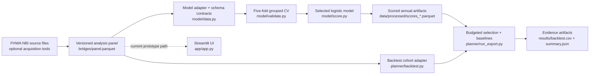

# BridgeTriage


> **Evidence-first decision intelligence for Massachusetts bridge inspections.**
>
> BridgeTriage turns a versioned FHWA National Bridge Inventory panel into an auditable inspection-prioritization workflow: validate the source, learn deterioration risk without looking into the future, account for consequence and inspection cost, select within a budget, and measure the strategy against historical outcomes.

BridgeTriage is deliberately built to resist the two most dangerous failures in public-infrastructure analytics: **invented certainty** and **quiet data leakage**. It does not treat missing condition ratings as a zero, does not use repair cost as inspection cost, does not train on future outcomes when backtesting, and does not present planning estimates as official measurements.

To try it out live - https://anishchugh05-bridgetriage-appapp-mohmqv.streamlit.app

## System status

| Layer | Current status | What that means |
| --- | --- | --- |
| Versioned Massachusetts bridge panel | **Operational** | `bridges/panel.parquet` contains the checked-in 2012, 2016, 2018, and 2022 analysis panel. |
| Decline model and scoring pipeline | **Operational** | The real pipeline selects and fits a model, then writes 2018 and 2022 score artifacts. |
| Historical backtest and export | **Operational** | The planner validates the 2018→2022 cohort and writes recall/weighted-recall artifacts with bootstrap intervals. |
| Streamlit experience | **Prototype adapter** | The checked-in entry point can fall back to fabricated stubs when its real imports fail. It is **not production-certified** until that broad fallback is removed and the real provider composition is wired in. |
| Dependency release gate | **Blocked** | `scripts/validate_dependencies.py` currently flags an undeclared `matplotlib` import in `planner/backtest.py`. This must be resolved before a production release. |

The analytical pipeline is real and reproducible. The UI and dependency gate are documented honestly because a system earns trust by surfacing its boundaries, not by hiding them.

## What BridgeTriage does

For every eligible bridge, the model estimates the likelihood of a **safety drop**: crossing into poor condition (worst deck/superstructure/substructure rating ≤ 4), or worsening further after already being poor. It then ranks inspection opportunities by expected value per dollar.

```text
score = p_worse × normalized consequence ÷ inspection cost × 10,000
```

- **`p_worse`** — model-estimated probability of a safety drop over the relevant planning window.
- **Consequence** — traffic-weighted importance, increased for rail/water crossings and poor condition.
- **Inspection cost** — a real cost if provided; otherwise an explicitly labeled drone-flight planning estimate.
- **Selection** — a budget-aware planner that charges a county mobilization fee once per selected county.
- **Evidence** — a historical backtest that picks with 2018 information and evaluates against 2022 outcomes.

This is a decision-support system, not an autonomous safety authority. It prioritizes where additional inspection effort may produce the most value; it does not replace engineering judgment, statutory inspection cycles, vendor quotes, or safety determinations.

## Architecture at a glance



Read the full component map, contracts, trust boundaries, and target production architecture in **[docs/architecture.md](docs/architecture.md)**.

## The trust model

BridgeTriage has non-negotiable analytical rules:

1. **Real data remains real.** Production analysis uses the checked-in FHWA-derived Massachusetts panel. Fabricated rows belong only in explicit test/demo fixtures.
2. **No lookahead.** The backtest trains on 2012→2016, ranks as of 2018, and only then checks 2022 outcomes. The two-year 2016→2018 gap is not used for four-year-horizon fitting.
3. **Missing does not mean bad.** NBI `N` / null condition values are not applicable, not numeric zeros. Rebuilt rows and bridges with non-comparable ratings are excluded from model/backtest cohorts.
4. **Costs remain estimates.** `improvement_cost` is a repair-cost field and is never used as an inspection price. Modeled flight cost and duration are disclosed as planning estimates.
5. **Every score is explainable.** The scorer produces technical and plain-language reasons alongside probability, consequence, cost, and rank.
6. **Artifacts are reproducible.** Dataset paths, score years, planner budgets, and exported outputs are fixed in source-controlled code.
7. **Failures should be explicit.** The repository includes typed error categories, exact runtime-mode parsing, deterministic cache identities, strict schemas, and dependency validation. These controls must be connected to the production UI before deployment.

## Quick start

### Prerequisites

- **Python 3.11** exactly (`.python-version` is authoritative)
- macOS/Linux shell or Windows PowerShell
- Git

From the repository root:

```bash
python3.11 -m venv .venv
source .venv/bin/activate
python --version  # must report 3.11.x
python -m pip install --require-hashes -r requirements.txt
python -m pip install --require-hashes -r requirements-test.txt
```

Windows PowerShell:

```powershell
py -3.11 -m venv .venv
.\.venv\Scripts\Activate.ps1
python --version
python -m pip install --require-hashes -r requirements.txt
python -m pip install --require-hashes -r requirements-test.txt
```

### Run the real analytical pipeline

```bash
# Select the model with grouped cross-validation and score 2018 + 2022.
python -m model.run

# Produce the real planner backtest and evidence exports.
python -m planner.run_export
```

Expected artifacts:

```text
data/processed/scores_2018.parquet
data/processed/scores_2022.parquet
results/backtest.csv
results/summary.json
```

### Run the prototype UI

```bash
python -m streamlit run app/app.py
```

The UI is useful for exploration, but **do not describe or deploy it as a production decision interface yet**. Its current broad import fallback can substitute `app/stubs.py` for the real model/planner path. The real pipeline commands above are the authoritative way to regenerate analytical artifacts today.

## Validate the repository

```bash
# Automated behavioral, model, planner, cache, and contract tests.
python -m pytest -q

# Dependency pins, interpreter version, import mapping, and production exports.
python scripts/validate_dependencies.py
```

Current checked-out baseline (validated 2026-10-24): **81 tests pass**. The dependency validator currently fails closed because `planner/backtest.py` imports `matplotlib` without an approved runtime-manifest mapping. That failure is intentional evidence that the release gate is doing its job; resolve it before declaring a release green.

## Data and evidence

### Canonical data asset

| Asset | Purpose | Authority |
| --- | --- | --- |
| `bridges/panel.parquet` | Versioned four-year Massachusetts NBI analysis panel | Runtime source for model and backtest |
| `bridges/README.md` | Fixed 21-column source schema and data rules | Source-data contract |
| `bridges/SUMMARY.md` | Panel sanity distributions and drop-rate summary | Data quality evidence |
| `data/processed/scores_2018.parquet` | 2018 model scores used by the exporter | Generated analytical artifact |
| `data/processed/scores_2022.parquet` | 2022 model scores | Generated analytical artifact |
| `results/backtest.csv` | Per-method, per-budget recall results and confidence intervals | Published backtest evidence |
| `results/summary.json` | Candidate-pool size, decliner count, and exclusions | Backtest provenance summary |

The published panel has fixed order and semantics. The source contract is owned by [`bridges/README.md`](bridges/README.md); downstream code must adapt it rather than rename or mutate it.

### Model evidence

The current selected model is a logistic regression without `months_since_insp`, chosen through bridge-grouped five-fold cross-validation. It uses condition, material, age, log traffic, inspection frequency, fracture-critical status, and underwater status. Read the full methodology, calibration, coefficients, and limitations in the **[model card](docs/model_card.md)**.

For a human-readable historical comparison of ranked picks and real 2022 outcomes, read **[docs/stories.md](docs/stories.md)**.

### Backtest scope

The backtest is an evidence tool, not a marketing chart. It:

- validates and aligns the 2018 candidate set with 2022 outcomes;
- excludes rebuilt, unmatched, duplicate, and not-applicable records consistently for every method;
- compares the model against worst-condition-first, oldest-first, random, and oracle strategies;
- reports unweighted and traffic-weighted recall separately;
- computes bootstrap confidence intervals for fixed-selection gaps; and
- labels the bootstrap limitation: it captures outcome-sampling variance, not selection variance.

The `oracle` strategy is an upper bound that uses realized outcomes. It is not a deployable policy and must never be represented as one.

## Repository guide

```text
Hackchusetts/
├── app/                    Streamlit prototype, UI styles, runtime/cache/error primitives
├── bridges/                Canonical panel, schema contract, source tooling, reference summaries
├── data/                   Raw acquisition workspace and generated model score artifacts
├── docs/                   Model card, evidence stories, and system architecture
├── model/                  Data adapter, target, model fitting, scoring, costs, validation, stories
├── planner/                Candidate filtering, selection, baselines, backtesting, export runners
├── results/                Versioned backtest CSV and summary JSON evidence
├── scripts/                Dependency/import contract validator
├── tests/                  Unit, model, planner, cache, and repository contract coverage
├── .kiro/specs/            Requirements/design/task records for major workstreams
├── fetch_years.py          Optional historical NBI acquisition and reconnaissance helper
├── requirements/           Direct pinned runtime and test dependency manifests
├── requirements.txt        Hash-locked runtime environment
├── requirements-test.txt   Hash-locked test environment
└── pytest.ini              Deterministic test collection configuration
```

### Ownership boundaries

| Boundary | Owns | Must not do |
| --- | --- | --- |
| `bridges/` | Published panel schema and data provenance | Be mutated by model or planner code |
| `model/` | Prediction target, fitting, scoring, explainability, cost estimates | Use post-pick outcomes while scoring historical picks |
| `planner/` | Budget selection, baselines, evaluation, confidence intervals | Reinterpret source schema or manufacture model scores |
| `app/` | Presentation, explicit runtime mode, safe errors, caching | Bypass contracts or silently substitute fabricated output |
| `results/` | Regenerated evidence artifacts | Be treated as a substitute for rerunning validation |

## Release standard

A BridgeTriage production release should be allowed only when all of the following are true:

- [ ] `python -m pytest -q` passes.
- [ ] `python scripts/validate_dependencies.py` passes using Python 3.11.
- [ ] `python -m model.run` regenerates the expected score artifacts from `bridges/panel.parquet`.
- [ ] `python -m planner.run_export` regenerates `results/backtest.csv` and `results/summary.json`.
- [ ] The Streamlit composition root uses explicit production/demo providers, validates their mode tags, and has **no** catch-all fallback to fabricated output.
- [ ] The Streamlit app renders a production run using the real score and planner contracts.
- [ ] Public labels preserve the distinction between FHWA observations, model probabilities, planning estimates, and historical backtest results.

Until every item is checked, the correct posture is **analytically functional, deployment gated**.

## Documentation index

- [System architecture](docs/architecture.md) — component graph, contracts, control plane, and release gates
- [Model card](docs/model_card.md) — target, features, validation, calibration, and limitations
- [Evidence stories](docs/stories.md) — historical picks compared with outcomes
- [Bridge data contract](bridges/README.md) — published panel schema and handling rules
- [Bridge panel summary](bridges/SUMMARY.md) — distributions and source sanity checks
- [Model package guide](model/README.md) — model API and execution details

## Contributing principles

1. Change contracts deliberately and document the migration.
2. Never add a production import without adding its exact pinned dependency and validator mapping.
3. Keep raw source acquisition separate from versioned analytical inputs.
4. Test data behavior at boundaries: source schema, score schema, identifier reconciliation, budget accounting, and backtest chronology.
5. Prefer explicit failures over believable-looking fabricated results.
6. Do not claim the system is perfect. Make it measurable, explainable, repeatable, and honest enough that teams can improve it with confidence.
