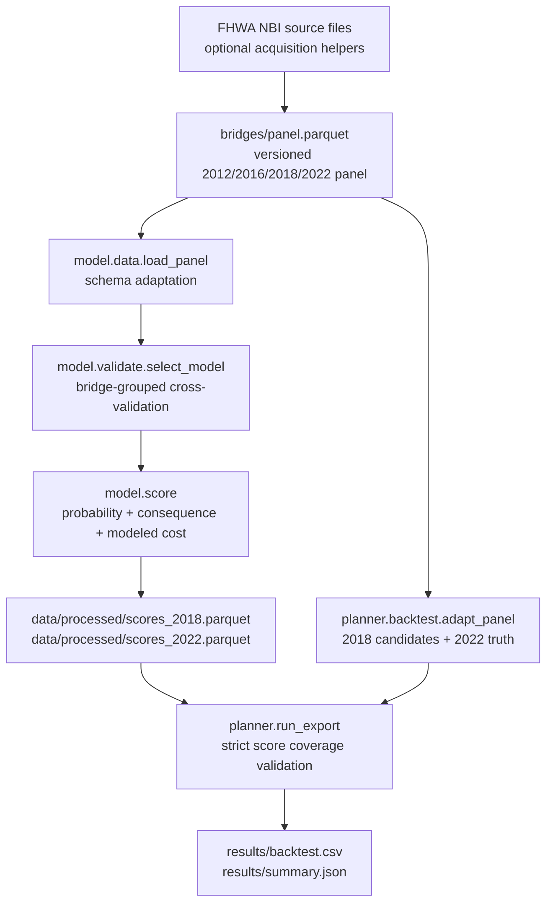
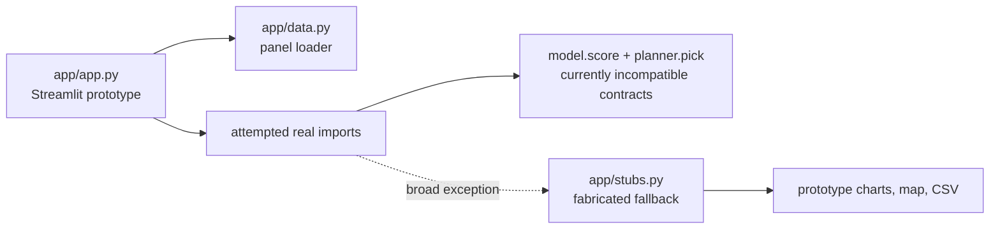
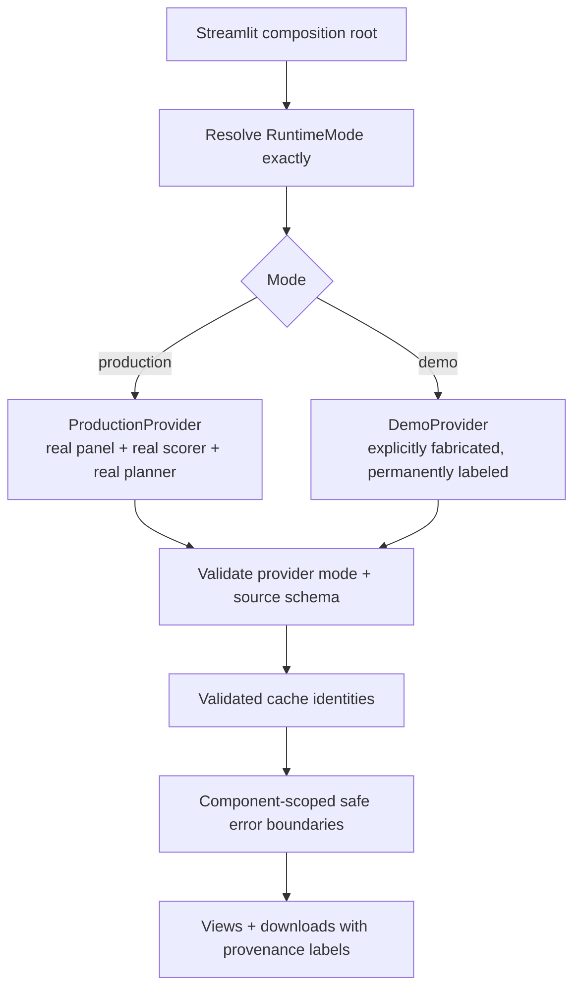

# BridgeTriage system architecture

## Purpose

BridgeTriage is an evidence-first inspection-prioritization system for Massachusetts bridges. Its job is not to issue safety findings or replace statutory inspection programs. Its job is to make one bounded decision transparent:

> Given a limited budget for additional inspections, which eligible bridges should receive extra scrutiny to maximize expected safety value per dollar?

The architecture separates source data, model logic, planning logic, published evidence, and presentation. That separation is the system’s main safety feature: each stage has a defined input, output, owner, and failure mode.

## Architecture posture

### Implemented today



### Presentation layer: current status



The UI contains valuable building blocks—strict runtime-mode parsing (`app/config.py`), public-safe error boundaries (`app/errors.py`), and deterministic validated cache identities (`app/services.py`)—but the current `app/app.py` does not compose them. It uses legacy top-level imports and a broad `except` that can route a real execution to fabricated stubs. That behavior is acceptable for a hackathon prototype; it is not acceptable for a production decision surface.

## System layers

| Layer | Primary code | Responsibility | Output |
| --- | --- | --- | --- |
| Source acquisition | `fetch_years.py`, `bridges/fetch.py`, `bridges/fetch.js` | Optional retrieval and reconnaissance of FHWA NBI data | Raw local files / reference snapshots |
| Data contract | `bridges/panel.parquet`, `bridges/README.md` | Fixed, versioned 21-column panel and source semantics | Canonical analytical input |
| Model adapter | `model/data.py` | Read the panel, adapt source names, preserve missingness, prohibit repair-cost misuse | Model-facing table |
| Target and fitting | `model/target.py`, `model/score.py`, `model/validate.py` | Define safety drops, build historical pairs, select a model without lookahead | Fitted scoring model |
| Cost / consequence / explainability | `model/flight_cost.py`, `model/materials.py`, `model/voi.py` | Model planning cost, flight time, consequences, score rationale, and value of information | Scored bridge table |
| Planner and backtest | `planner/backtest.py`, `planner/run_export.py` | Build comparable candidate pool, pick within budget, compute baselines and metrics | Backtest table + intervals |
| Evidence publication | `results/`, `docs/model_card.md`, `docs/stories.md` | Preserve model facts and historical outcomes | Human-reviewable evidence |
| Presentation/control plane | `app/` | Render results, expose run mode, cache validated values, show safe failures | Streamlit application |
| Quality gate | `tests/`, `scripts/validate_dependencies.py`, `pytest.ini` | Verify behavior, contracts, dependencies, and runtime compatibility | Release evidence |

## Canonical data flow

### 1. Source panel

`bridges/panel.parquet` is the canonical runtime source. It contains one row per `(structure_id, year)` for 2012, 2016, 2018, and 2022. The schema is fixed and documented in [`bridges/README.md`](../bridges/README.md).

Critical semantics:

- `worst_rating` is the minimum of deck, superstructure, and substructure ratings.
- A null `worst_rating` means not applicable, not condition zero.
- `rebuilt` represents a reconstruction or condition improvement; rebuilt rows do not represent ordinary deterioration.
- `improvement_cost` is a repair-cost field. It is prohibited as an inspection cost.
- The four-year intervals are 2012→2016 and 2018→2022. The 2016→2018 interval is two years and is excluded from four-year model fitting/backtesting.

### 2. Model fitting and scoring

`model.run` is the canonical scoring runner:

1. Load the canonical panel through `model.data.load_panel()`.
2. Evaluate candidate models with bridge-grouped cross-validation over the 2012→2016 training horizon.
3. Select the model using the documented simplicity-aware rule.
4. Score 2018 and 2022 snapshots.
5. Write `data/processed/scores_2018.parquet` and `data/processed/scores_2022.parquet`.

The selected model is a logistic regression without `months_since_insp`. It returns, for each eligible bridge, a probability of safety drop, consequence, inspection cost, flight time, expected drops per $10k, score, value of information, action label, and both technical and human-readable reasons.

### 3. Planner and historical evidence

`planner.run_export` creates the backtest evidence:

1. Adapt 2018 and 2022 source rows to the planner contract.
2. Validate ratings, IDs, costs, and source columns.
3. Apply the same exclusion policy to every method: unmatched, rebuilt, duplicate, not-applicable, or incomplete rows leave the candidate pool.
4. Use the complete 2018 model-score artifact for the candidate set; missing candidate coverage is a hard error.
5. Run model, worst-condition-first, oldest-first, random, and oracle comparators across fixed budget fractions.
6. Export recall, traffic-weighted recall, and fixed-selection bootstrap intervals.

The oracle is a diagnostic ceiling that sees realized outcomes. It is intentionally non-deployable and must never be presented as a model result.

## Contract boundaries

### Source → model

| Contract | Enforcement |
| --- | --- |
| Exact source column order and semantics | `model.data.SOURCE_COLUMNS`, source validation tests |
| One 2022 row per `structure_id` | Source/reconciliation validation |
| Missing condition is not numeric condition | Schema semantics, model filtering |
| `improvement_cost` is not inspection cost | Model adapter and cost-model contract |
| No in-place mutation of published source | `model.data.load_panel()` returns a copy |

### Model → planner

| Contract | Enforcement |
| --- | --- |
| Scored IDs must be a bijection with the ranking population | `reconcile_scored_table()` / strict export score loader |
| Probability and score are finite | Scored-table validation |
| Score arithmetic is internally consistent | `score ≈ p_worse × consequence ÷ insp_cost` validation |
| Reasons are non-empty and disclose modeled cost | Scored-table validation |
| Model score file covers all candidates | `planner.run_export.load_model_scores()` |

### Planner → published evidence

| Contract | Enforcement |
| --- | --- |
| Every method uses the same candidate pool | Candidate filtering is performed once before scoring methods |
| County fee is paid once per selected county | Shared `marginal_cost()` / `cost_accounting()` rule |
| Evaluation uses outcome and traffic, not model score, as truth/weight | `evaluate_metrics()` |
| Confidence intervals declare their scope | Export prints the fixed-selection bootstrap caveat |

## Control plane and failure design

### Runtime modes

`app/config.py` defines exact, case-sensitive modes:

- Missing `BRIDGE_APP_MODE` resolves to `production`.
- `BRIDGE_APP_MODE=production` selects production.
- `BRIDGE_APP_MODE=demo` selects demo.
- Any other supplied value raises before provider/data construction.

This is a strong contract, but it becomes an operational guarantee only after `app/app.py` makes mode resolution its first step and uses the result to choose a mode-tagged provider.

### Safe public errors

`app/errors.py` maintains a fixed registry of public component/code/summary messages. Internal exception details are structured-log-only; public rendering exposes only the approved component, summary, and code. This protects source records, paths, environment values, and internal exception messages from being shown to users.

### Deterministic cache identity

`app/services.py` provides deterministic SHA-256 identities for:

- source file contents;
- fitted model state;
- scored tables;
- backtest results.

Identities include mode, semantic inputs, source digest, horizons, dates, budgets, and configuration fingerprints. Cache entries are validated transactionally, and a failed computation does not become a cached success.

## Target production composition

Before deploying a Streamlit UI, replace the current prototype adapter with this composition model:



Required implementation rules:

1. Use only package imports from the repository root (`from app...`, `from model...`, `from planner...`).
2. Remove every catch-all fallback that can substitute stubs for a production failure.
3. Keep a demo provider only behind an explicit `BRIDGE_APP_MODE=demo` setting and label every demo-derived view/download.
4. Validate source schema and model-score reconciliation before rendering data-derived UI.
5. Cache only validated artifacts with source/configuration-sensitive identities.
6. Surface fixed public errors; log the internal exception once.
7. Make provenance visible: source asset, model family, as-of date, score artifact, and backtest artifact.
8. Verify a browser render against real data before release.

## Quality and release gates

### Current evidence

- `python -m pytest -q` passed **81 tests** on 2026-10-24.
- `python -m model.run` generated both score artifacts successfully on 2026-10-24.
- `python -m planner.run_export` generated the real backtest evidence successfully on 2026-10-24.
- `python scripts/validate_dependencies.py` is currently **red**: it finds a `matplotlib` import in `planner/backtest.py` with no approved runtime dependency mapping.

### Mandatory release sequence

```bash
python -m pytest -q
python scripts/validate_dependencies.py
python -m model.run
python -m planner.run_export
python -m streamlit run app/app.py
```

A release is eligible only when all commands succeed, the Streamlit page is visually verified with the real provider, and no production path can use demo or stub output.

## Observability and artifact provenance

| Question | Evidence location |
| --- | --- |
| What source schema/version did we use? | `bridges/README.md`, source file digest/cache identity |
| How does the model work and where can it fail? | `docs/model_card.md` |
| Which score artifact was evaluated? | `data/processed/scores_2018.parquet` |
| How many bridges entered the backtest pool and why were others excluded? | `results/summary.json` |
| What did each method achieve by budget? | `results/backtest.csv` |
| What does an application failure mean publicly? | `app/errors.py` registry |
| Is the installed runtime exactly approved? | `scripts/validate_dependencies.py` |

## Non-goals and limitations

- BridgeTriage is Massachusetts-specific and must not be transferred to another jurisdiction without revalidation/refitting.
- Model probabilities, costs, and flight durations are planning estimates—not official condition findings, engineering assessments, or vendor quotes.
- The planner’s bootstrap intervals quantify outcome-sampling variation for fixed selections, not model-selection uncertainty or operational deployment variance.
- A successful model/backtest run does not certify the current Streamlit interface; the UI has its own integration gate.
- The system does not automate inspection mandates, work orders, repair prioritization, or public-safety decisions.

## Design principle

The strongest version of BridgeTriage is not the one that claims to be flawless. It is the one that makes every important assumption inspectable, every artifact reproducible, every limitation visible, and every release claim testable.
